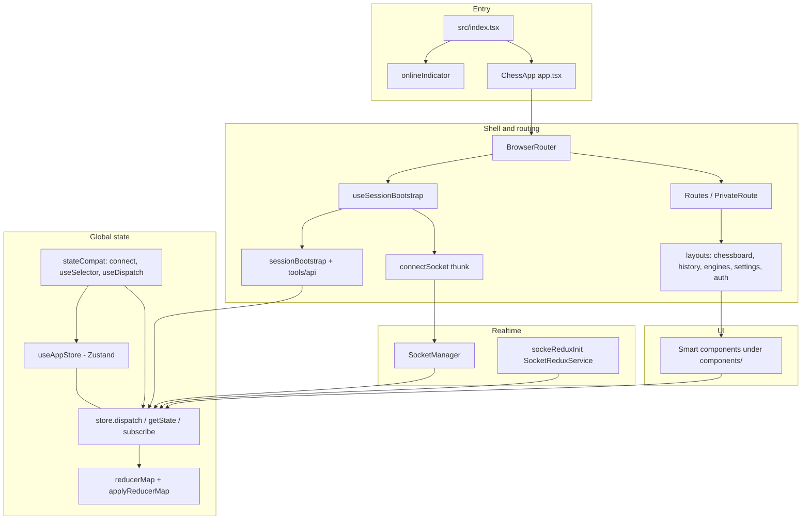
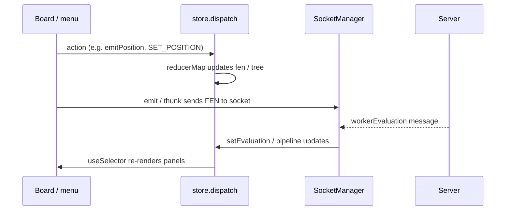

# Client architecture

This document describes how the **chess-analysis-gui** browser client is structured: entry flow, global state, routing, networking, and where feature code lives. It reflects the current implementation in `src/`.

## Goals of this stack

- One place for **application state** that many panels and the board can read and update.
- **Socket.io** for streamed engine output and server-driven book/tablebase payloads, mapped into the same state as REST-driven updates.
- **Lazy-loaded routes** to keep the initial bundle smaller.
- **Session bootstrap** before showing the main UI when a JWT is present (profile + last game, then socket).

---

## High-level diagram

---

## Entry point

| File            | Role                                                                                                                             |
| --------------- | -------------------------------------------------------------------------------------------------------------------------------- |
| `src/index.tsx` | Loads global CSS, calls `onlineIndicator()`, renders `<ChessApp />` into `#root`, registers the service worker.                  |
| `src/app.tsx`   | `BrowserRouter`, session bootstrap, loading gate, lazy `Suspense` routes, public auth routes vs `PrivateRoute` for the main app. |

There is **no** classic React-Redux `<Provider>`. Components use `src/libs/stateCompat.tsx` (`connect`, `useSelector`, `useDispatch`) backed by Zustand, or import `store` directly where needed.

---

## Global state model

### Store implementation (`src/store.ts`)

- `**useAppStore`** — Zustand `create` store holding the full `ReduxStateShape`.
- `**store.dispatch(action)**` — If `action` is a function, it is invoked as a **thunk** `(dispatch, getState) => …`. If `action.type === "BATCH_ACTIONS"`, the payload array is applied in order. Otherwise the action is passed through `**applyReducerMap`**.
- `**store.getState` / `store.subscribe**` — Imperative access and manual subscriptions (some services and reducers use `getState`).

Initial state is built by running each reducer in `reducerMap` once with a synthetic `@@INIT` action.

### Reducer map (`src/reducers.tsx`)

- Defines `**ReduxStateShape**`: one flat object of slices (`loading`, `user`, `fen`, `evaluation`, `history`, `menu`, `socket`, `gameDatabase`, …).
- `**reducerMap**` maps slice keys to slice reducers. `**applyReducerMap**` runs every slice reducer on each action (Redux-style, without combineReducers import).

Slice implementations are **split across the tree**:

- Core slices in `src/reducers.tsx`.
- Feature slices next to UI: e.g. `components/history/historyReducers.ts`, `components/menu/menuReducers.ts`, `services/socketService.ts`, `services/errorManager.ts`, `layouts/settingPageReducers.ts`.

### React bindings (`src/libs/stateCompat.tsx`)

- `**useSelector(selector, equalityFn?)`** — Subscribes via `useAppStore` so components re-render when selected data changes.
- `**useDispatch()**` — Returns `store.dispatch`.
- `**connect(mapState, mapDispatch)**` — Higher-order component wrapping `useSelector` / `store.dispatch`, similar to react-redux for legacy or class-style wiring.

Many “smart” components still use `**connect**`; others call `**store.dispatch` / `store.getState**` directly.

---

## Session and routing

### Bootstrap (`src/hooks/useSessionBootstrap.ts`, `src/services/sessionBootstrap.ts`)

1. Read JWT (via `SessionManagerService.getToken()` in `ChessApp`).
2. If **no token**: mark loaded; main routes still go through `PrivateRoute` (unauthenticated users hit sign-in when needed).
3. If **token**: `GET` profile and last history; on success dispatch `USER_SIGN_IN` and `SET_HISTORY`, then call `**connect(token)`** (wired to `store.dispatch(connectSocket(sessionToken))`).

Errors surface as inline `Error` components for profile vs history failures; until `isLoaded`, `Loading` is shown.

### Routes (`src/app.tsx`, `src/libs/privateRoute.tsx`)

| Path                                                                  | Access                    |
| --------------------------------------------------------------------- | ------------------------- |
| `/`                                                                   | Private — main board page |
| `/user/engines`, `/user/history`, `/settings`                         | Private                   |
| `/auth/sign-in`, `/auth/google-popup`, `/auth/verify-google-response` | Public                    |

Page **shells** live under `src/layouts/` and compose feature components from `src/components/`.

---

## Networking

### REST

- `**src/tools/api.tsx`** — URL builders and fetch helpers used by bootstrap, history, workers, etc.
- `**src/config/index.ts**` — Hosts and paths from `process.env` (Webpack `DefinePlugin`).

### Socket.io

- `**src/services/socketManager.ts**` — Main client connection lifecycle, evaluation pipeline hooks, dispatches into the store when results arrive.
- `**src/libs/sockeReduxInit.tsx**` — `**SocketReduxMiddleware**`: registers listeners that `**store.dispatch({ type, payload })**` for known message keys (`workerEvaluation`, `openingMoves`, …). Used where the older middleware pattern is still wired.
- `**src/services/sockets/actions.ts**` — Thunks such as `**connectSocket**` used from session bootstrap.

Server events are normalized into **plain actions** consumed by the same `reducerMap` as UI actions.

---

## UI organization

| Area                                                                           | Responsibility                                                                                       |
| ------------------------------------------------------------------------------ | ---------------------------------------------------------------------------------------------------- |
| `src/layouts/`                                                                 | Route-level pages: board layout (portrait/landscape), history list, engines, settings, auth screens. |
| `src/components/chessboard/`                                                   | Board controller, Chessground wiring, promotion, move indicators.                                    |
| `src/components/evaluation/`                                                   | Offline Stockfish (worker), cloud evaluation UI, pipeline glue.                                      |
| `src/components/openingExplorer/`, `gamesDatabaseExplorer/`, `syzygyExplorer/` | Side panels; reducers co-located.                                                                    |
| `src/components/moveTree/`                                                     | Move tree / node model shared with history and evaluation attachment.                                |
| `src/components/menu/`, `infoPanel/`, `Panel.tsx`                              | Navigation, tabs, aggregated side UI.                                                                |

“Smart” components are typically `**connect`**-ed or import `**store**` to dispatch thunks (e.g. batch position + opening + DB loads on navigation).

---

## Typical flow: position change and cloud evaluation

(Exact action names vary; see `src/actions.tsx` and evaluation services.)

---

## Experimental / unused paths

- `**src/stores/**` (`analysisStore.ts`, `gameStore.ts`, `sessionStore.ts`, `uiStore.ts`) — Present in the tree but **not imported** by the running app today. The live source of truth remains `**src/store.ts`** + `**reducers.tsx**`. Treat `src/stores/` as exploratory unless wiring is added.

---

## Related files quick reference

| Concern         | Primary files                                                                                     |
| --------------- | ------------------------------------------------------------------------------------------------- |
| State container | `src/store.ts`, `src/reducers.tsx`                                                                |
| React bindings  | `src/libs/stateCompat.tsx`                                                                        |
| App shell       | `src/app.tsx`                                                                                     |
| Session start   | `src/hooks/useSessionBootstrap.ts`, `src/services/sessionBootstrap.ts`                            |
| Sockets         | `src/services/socketManager.ts`, `src/libs/sockeReduxInit.tsx`, `src/services/sockets/actions.ts` |
| Auth guard      | `src/libs/privateRoute.tsx`                                                                       |
| Env / API base  | `src/config/index.ts`, `src/tools/api.tsx`                                                        |

---

## Keeping this doc accurate

When you change how state is held (e.g. fully migrate to `src/stores/` or add a Provider), update this file and the **Tech stack** / **Repository layout** sections in `README.md` so newcomers see one consistent story.